<p align="center">
  <picture>
    <source media="(prefers-color-scheme: dark)" srcset="brand/lockup/tawreed-lockup-white.svg">
    
  </picture>
</p>

<h3 align="center">From bills of quantities to procurement packages. Every number has a source.</h3>

<p align="center" dir="rtl">توريد يحوّل جداول الكميات إلى حزم توريد جاهزة للتسعير، بالعربية والإنجليزية. كل رقم له مصدر.</p>

<p align="center">
  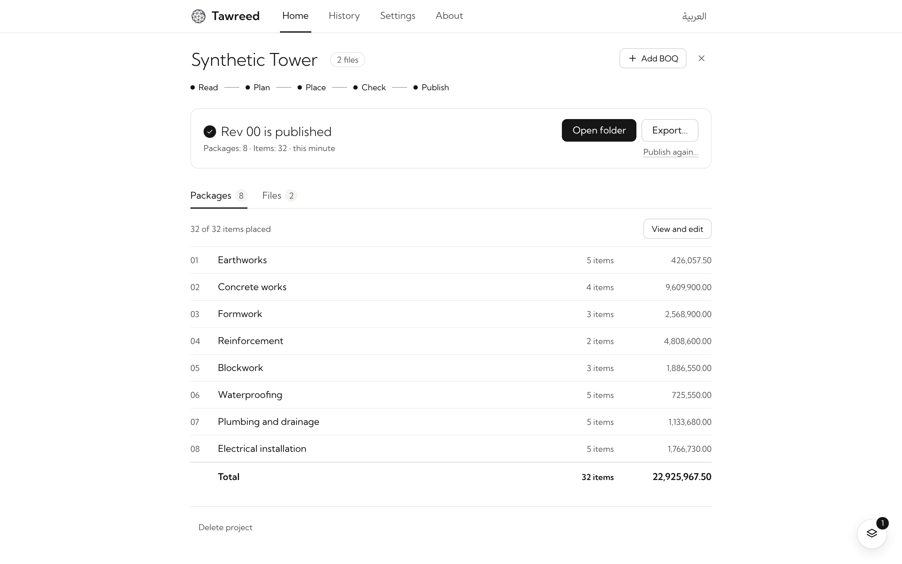
</p>

Tawreed is a desktop app by [QS Mind](https://qsmind.app/en/tawreed) for quantity surveyors, estimators and
procurement engineers. Drop the BOQs for a project and Tawreed reads them, proposes a package structure, places
every item in exactly one package, and publishes a master workbook plus one workbook per package, ready to send to
suppliers and subcontractors for pricing. You approve at every gate, and nothing in your BOQ is ever changed.

## Download

<p>
  <a href="https://github.com/qs-mind/tawreed/releases/latest/download/Tawreed_x64-setup.exe"></a>
  &nbsp;
  <a href="https://github.com/qs-mind/tawreed/releases/latest/download/Tawreed_aarch64.dmg"></a>
  &nbsp;
  <a href="https://github.com/qs-mind/tawreed/releases/latest/download/Tawreed_x64.dmg"></a>
  &nbsp;
  <a href="https://github.com/qs-mind/tawreed/releases/latest/download/Tawreed_amd64.AppImage"></a>
</p>

| System | File |
| --- | --- |
| Windows 10 and 11, 64-bit | [`Tawreed_x64-setup.exe`](https://github.com/qs-mind/tawreed/releases/latest/download/Tawreed_x64-setup.exe): installs for your user, no administrator rights needed |
| Mac with Apple silicon (M1 or newer), macOS 13 or newer | [`Tawreed_aarch64.dmg`](https://github.com/qs-mind/tawreed/releases/latest/download/Tawreed_aarch64.dmg): open it and drag Tawreed to Applications first |
| Mac with an Intel chip, macOS 13 or newer | [`Tawreed_x64.dmg`](https://github.com/qs-mind/tawreed/releases/latest/download/Tawreed_x64.dmg): open it and drag Tawreed to Applications first |
| Linux, 64-bit | [`Tawreed_amd64.AppImage`](https://github.com/qs-mind/tawreed/releases/latest/download/Tawreed_amd64.AppImage): make it executable (`chmod +x Tawreed_amd64.AppImage`), then open it |

All versions, checksums (`SHA256SUMS.txt`) and release notes are on the [Releases page](https://github.com/qs-mind/tawreed/releases).

> **Windows SmartScreen.** The Windows installer is not code-signed yet, so Windows may show "Windows protected your
> PC" the first time you run it. Choose **More info**, then **Run anyway**.

> **Mac first run.** The Mac app is not signed with an Apple developer certificate, so macOS will not open it
> straight away. Drag Tawreed to **Applications** first and open it from there. When macOS says it cannot verify
> Tawreed, open **System Settings**, **Privacy & Security**, scroll down and click **Open Anyway** next to
> Tawreed, then confirm. If that button does not appear, run `xattr -dr com.apple.quarantine /Applications/Tawreed.app`
> in Terminal and open Tawreed again. To check your download first, compare `shasum -a 256 Tawreed_aarch64.dmg`
> (or `Tawreed_x64.dmg`) with the line in `SHA256SUMS.txt` on the Releases page.

Tawreed checks for a new version once when it opens. When one is out it offers it, and installs it only when you
press **Update and restart**. Updates are signed, and the app installs only an update whose signature matches the
key built into it.

## See it work

Watch the launch film and the step-by-step guide, with a short clip for every step, on the
[Tawreed page](https://qsmind.app/en/tawreed#guide) ([بالعربية](https://qsmind.app/ar/tawreed#guide)).

<p align="center">
  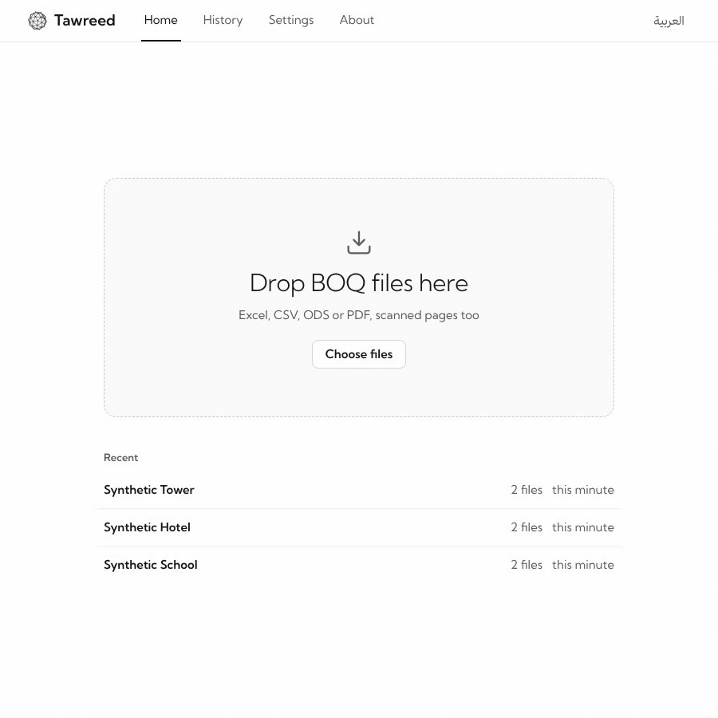
</p>

An item Tawreed could not place with confidence waits for you. You pick the package, Tawreed asks to publish and
shows what the revision holds, you publish, and any item opens straight to its row in your BOQ.

## How it works

Tawreed is a fixed workflow, not a chat. It runs on its own from the dropped BOQ to each gate, and the gates always
stop for you.

1. **Read.** Tawreed keeps an unchanged copy of each file. The AI works out each file's layout (which sheet, which
   header row, which column is the quantity, where a PDF's columns fall); Tawreed then extracts the exact values,
   each item linked to its cell or page. Rows the AI reads from a scanned page are marked "read from image, verify"
   and shown beside the page.
2. **Overlapping files** *(gate)*. When a new file overlaps the project's existing files, you say whether it is an
   addition, a replacement or a revision.
3. **Package plan** *(gate)*. The AI proposes the packages: a name, the scope each covers and why, along the trades
   suppliers and subcontractors actually price. Approve it, edit it first (rename, change the scope, remove, merge,
   add), or have it proposed again with a note.
4. **Place.** The AI places every item in one package.
5. **Uncertain items** *(gate)*. Items it cannot place with confidence come to you with the candidate packages and
   its reasoning. You pick, for this item, this project or all future projects.
6. **Check.** Tawreed verifies that every item appears exactly once and that the package totals reconcile with the
   source totals.
7. **Publish** *(gate)*. Tawreed shows what the revision holds, computed, and writes it only when you approve: all of
   it, or none of it.

The AI proposes; Tawreed computes. The AI never writes an item's code, description, unit, quantity, rate or amount,
and every count and total you see is Tawreed's own arithmetic. You correct the work directly (move items, rename,
merge, remove or add packages, set a sheet's columns, set a page aside) or by running a step again with a note.

## What you get

Each publish is a numbered revision (`Rev 00`, `Rev 01`, …) kept with the project, with **Open folder** and
**Export…**:

- **Master workbook:** a cover, a package index with item counts and totals, and one sheet per package.
- **Package workbooks:** one standalone workbook per package, ready to send. You choose whether they show your rates
  and amounts, or leave the rates empty for suppliers to fill.
- **Simple formulas:** amounts are `=Qty*Rate` wherever that gives your BOQ's own amount (otherwise your figure
  stays), package totals are `=SUM(...)`, and the cover adds up the index.
- **Decision log:** what the AI proposed and what you decided, with the reasons.
- **Coverage check:** every source item once, and source totals against output totals.

Item codes, descriptions, units, quantities, rates, amounts and comments reach the workbooks exactly as they are in
your BOQ, and every item keeps its source sheet and row, or page. Arabic projects get right-to-left sheets.

## Limits of use / حدود الاستخدام

Tawreed helps you sort BOQ items into procurement packages and publish them as workbooks for pricing. It does not
design, calculate loads or approve anything. Everything it produces is for review; checking and approval rest with
the engineer and the firm.

- Codes, descriptions, units, quantities, rates and amounts are copied from your BOQs as they are. Tawreed does not
  check them against drawings or specifications, and the rates are your BOQ's, not market prices.
- The package plan and the placing of items are the AI's proposals. Confirm each package's scope and specifications
  before you send it out.
- Rows read from a scanned page are marked: check them against the page.

Every printed sheet of a revision is headed "For review". The master's cover and each package sheet state these
limits in one line, and the cover lists the assumptions behind the figures. The app shows them under the drop zone
and in **About**.

<p dir="rtl">يساعدك توريد في توزيع بنود جداول الكميات على حزم توريد وإصدارها في مصنفات جاهزة للتسعير. لا يصمّم ولا يحسب أحمالاً ولا يعتمد أي شيء. كل ما يخرج منه للمراجعة، والتحقق والاعتماد مسؤولية المهندس والشركة. تُنقل الكميات والأسعار والمبالغ من جداول الكميات كما هي، والأسعار أسعار جدولك لا أسعار السوق، وخطة الحزم وتوزيع البنود اقتراحات تؤكدها قبل الإرسال.</p>

## Files it reads

- Excel: `.xlsx`, `.xlsm`, `.xls`
- OpenDocument: `.ods`
- CSV, including Arabic text saved as Windows-1256
- PDF, searchable or scanned
- Page images: `.png`, `.jpg`, `.jpeg`, `.tif`, `.tiff`, `.webp`

Any layout: there is no template to follow. English, Arabic or both. Up to 100 MB per file.

## AI connections

Tawreed works with the AI service you choose, in **Settings**:

- your own API key for **Anthropic**, **OpenAI**, **Google**, **xAI**, or one **OpenAI-compatible** service; or
- a **ChatGPT** subscription, through the official Codex client. Tawreed never reads or copies its sign-in tokens.

Before a model can be used, Tawreed checks that it calls Tawreed's tools correctly, and records whether it can read
page images (scanned pages need that). Without a working connection your projects, files and past revisions stay
open, and the AI steps wait.

## Your data stays on your PC

- Everything lives in `~/.tawreed` on your computer: settings, projects, the copies of your files and every
  revision. Supplied files are never changed.
- API keys are kept in `~/.tawreed/auth.json`, readable only by your user account. Tawreed shows only a key's last
  four characters and sends a key only to its own service.
- A project's content goes only to the AI service you picked, and only after you allow it: the first time, a card
  names the service and says what would be sent. Your keys and your other projects are never sent.
- Text in a BOQ, PDF, image or comment is treated as data, never as instructions.
- The app's local service listens only on `127.0.0.1`, with a fresh access token for each launch.

To report a security problem, see [SECURITY.md](SECURITY.md).

## Screenshots

### English

| | |
| --- | --- |
| 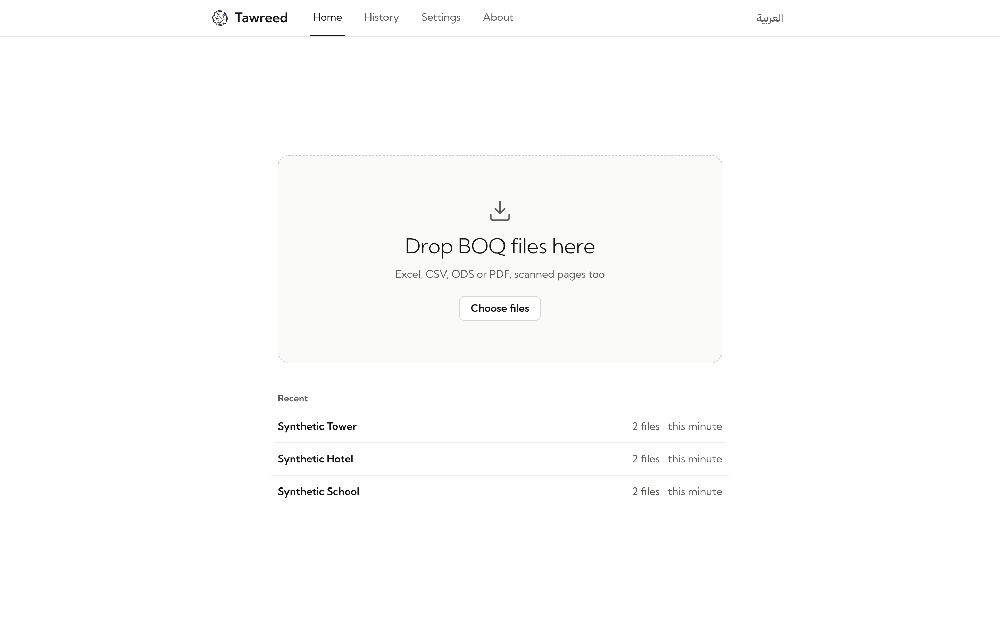 | 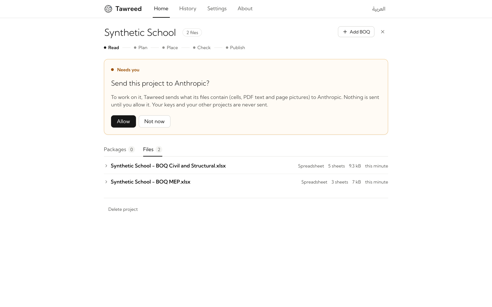 |
| **Home.** Drop BOQs and the work starts. | **Consent.** Nothing is sent until you allow it. |
| 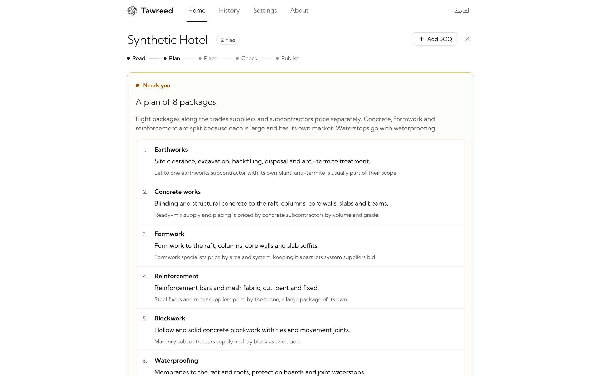 | 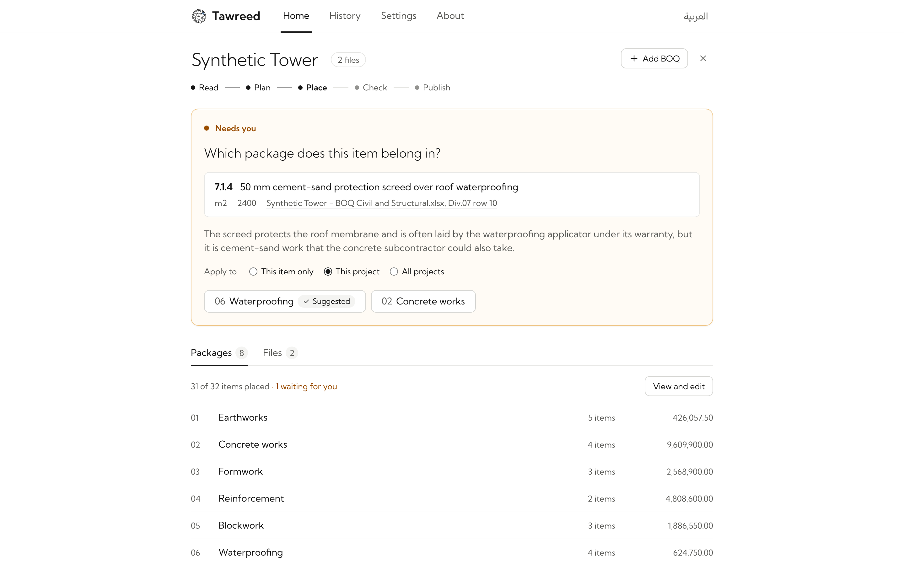 |
| **Package plan.** Approve, edit or propose again. | **Uncertain item.** You pick the package. |
| 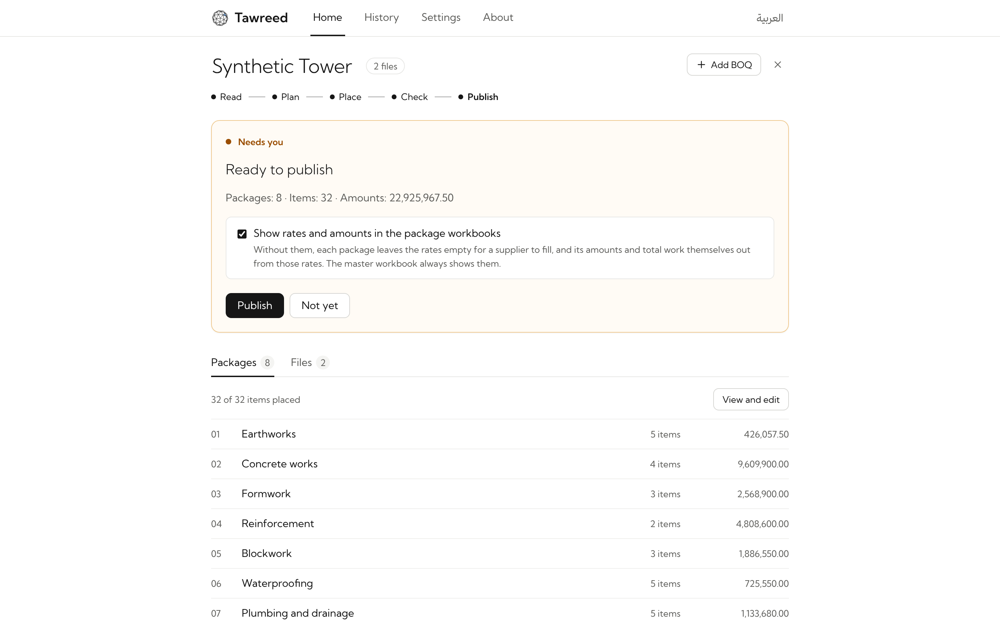 | 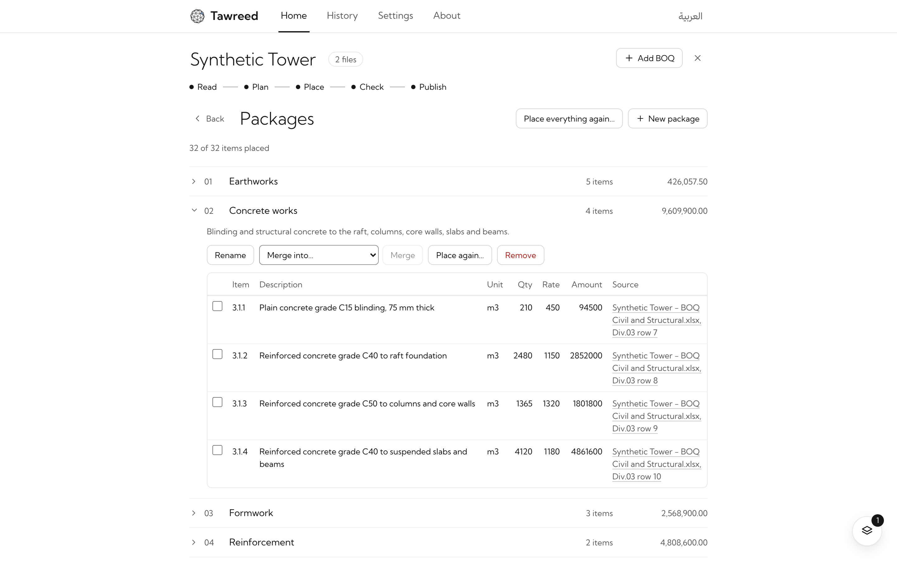 |
| **Publish.** What the revision holds, computed. | **Packages.** Every item with its source. |
| 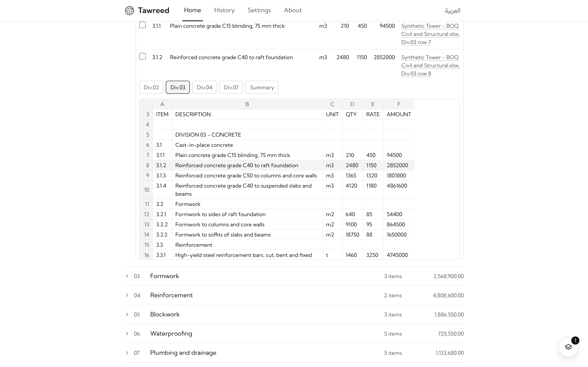 | 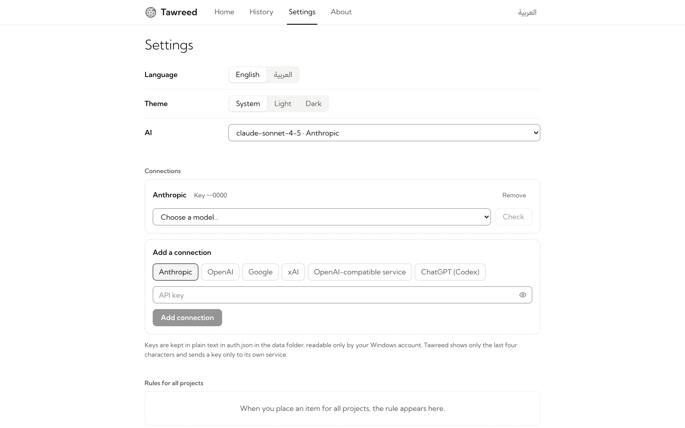 |
| **Source.** One click to the cell. | **Settings.** Your AI connection and model. |
| 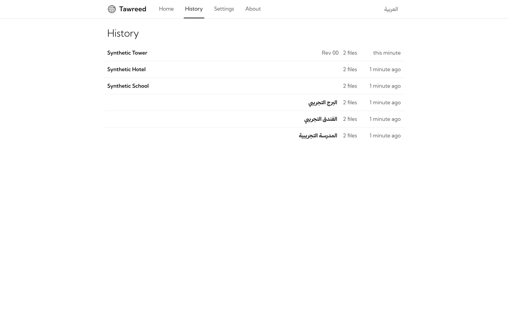 | |
| **History.** Past projects and revisions. | |

### العربية

| | |
| --- | --- |
| 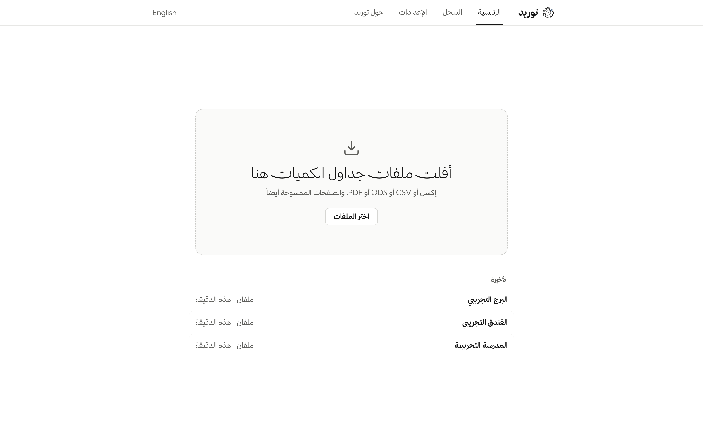 | 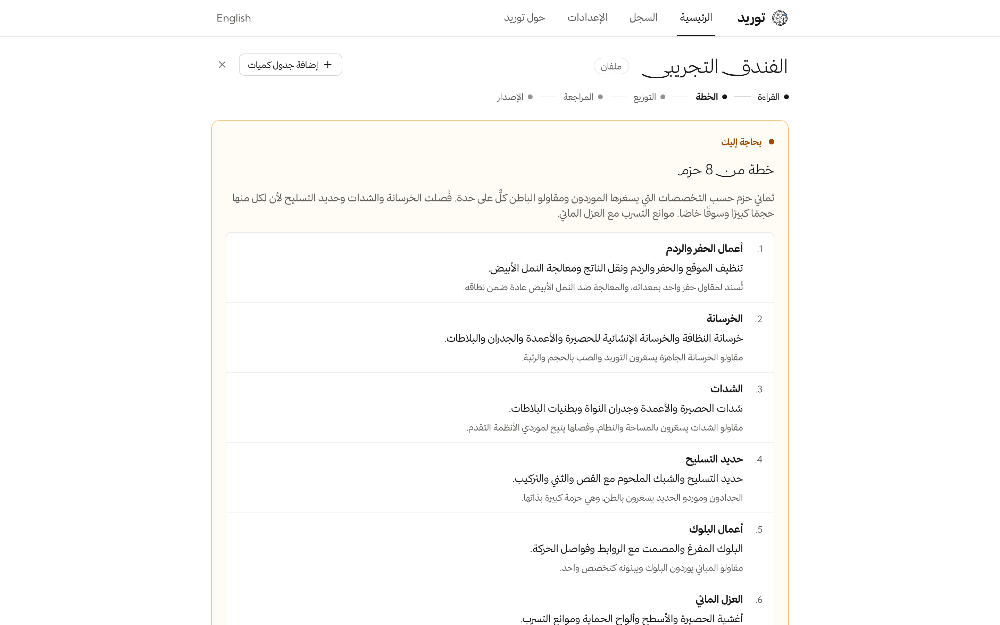 |
| **الرئيسية** | **خطة الحزم** |
| 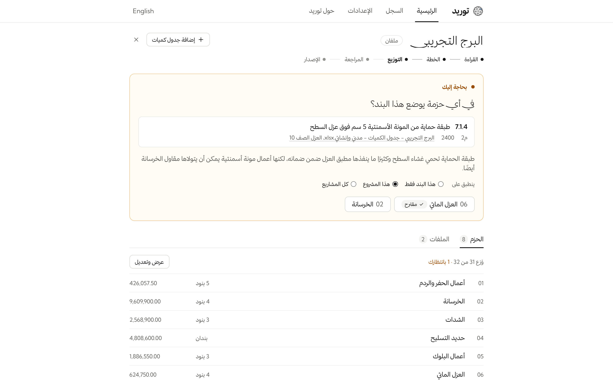 | 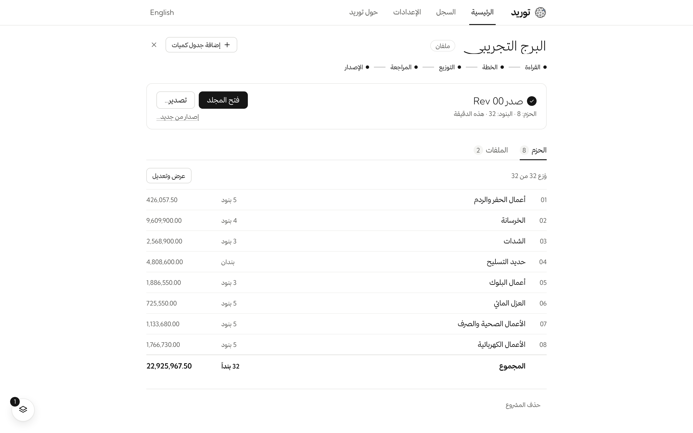 |
| **بند غير مؤكد** | **الإصدار المنشور** |
| 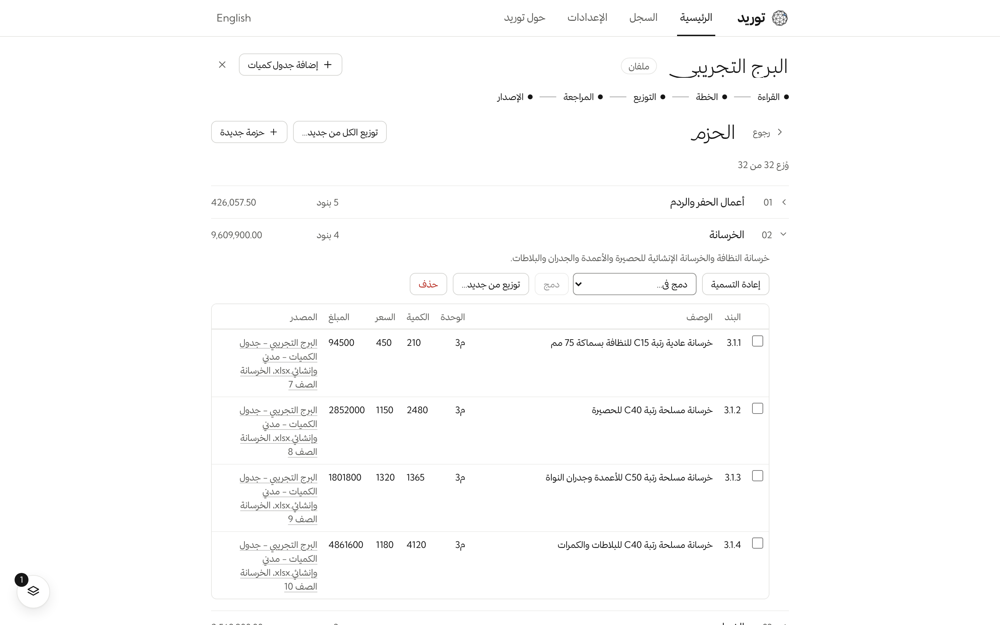 | 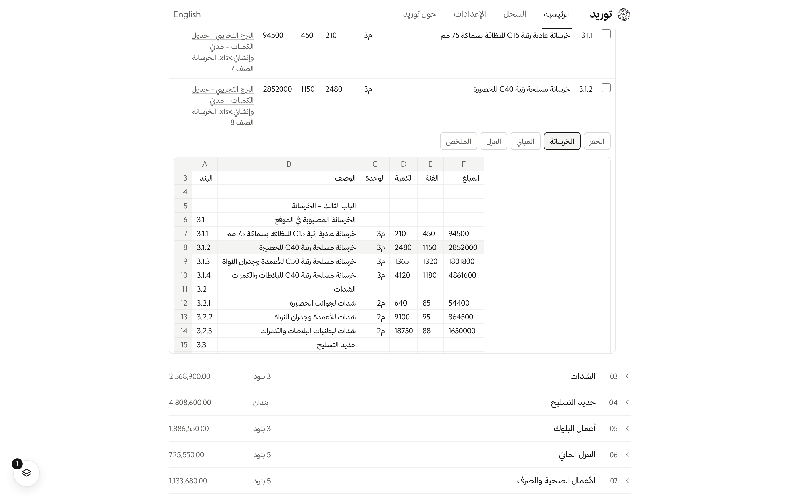 |
| **بنود الحزمة** | **المصدر** |

All screenshots use made-up projects ("Synthetic Tower" and others) with synthetic BOQs.

## Development

You need Python 3.12, Node 24 or later, and the Tauri 2 prerequisites for your system (including Rust). Set up
once:

```powershell
py -3.12 -m venv service/.venv
service/.venv/Scripts/python -m pip install -e "./service[dev]"
npm ci
```

On macOS or Linux, create the environment with `python3.12 -m venv service/.venv` and install with
`service/.venv/bin/python -m pip install -e "./service[dev]"`.

**Arabic font.** Tawreed's Arabic typeface, Thmanyah Sans, may only ship inside the compiled app, so it is not in
this repository. The GitHub builds use the open IBM Plex Sans Arabic instead. Put the `-Light`, `-Regular`, `-Medium` and `-Bold` `.woff2` files of `thmanyahsans` from the
official download into `ui/src/fonts/thmanyah/` (ignored by git). Without them Arabic uses the system font. Never
commit, upload or host these files.

`npm run dev` starts the interface at `http://localhost:1430`. The dev server also starts the service on a free
local port with a fresh access token, and forwards `/api` to it. `npm run tauri dev` opens the same interface in
the desktop window; on Windows, double-clicking `Start-Tawreed.cmd` does the same. Set `TAWREED_HOME` to use
another data folder, for example a scratch folder for testing.

| Command | What it does |
| --- | --- |
| `npm run test:service` | Service tests |
| `npm run test:ui` | Interface tests |
| `npm run check` | Typecheck, Ruff and Clippy |
| `npm run verify` | `check`, then the service, interface and release-script tests |
| `npm run build` | Typecheck and production build of the interface into `dist/` |
| `npm run bindings` | Regenerate the interface's API types from the service |

Run `npm run verify` before every push. CI runs the same checks, and fails if the API types are out of date, only
when started by hand (Actions → CI → Run workflow).

The specification is [docs/spec.md](docs/spec.md), the architecture [docs/architecture.md](docs/architecture.md)
and the record of the work [docs/progress.md](docs/progress.md).

## Windows, Mac and Linux packages

`npm run package` freezes the service with PyInstaller into `service/dist/tawreed-service/` and builds the NSIS
installer into `desktop/target/release/bundle/nsis/`. The installed app starts that service itself on a free local
port with a fresh token, forwards the interface's requests to it, and the service stops when the app does. Its log
is `service.log` in the app's log folder (`%LOCALAPPDATA%\com.qsmind.tawreed\logs` on Windows,
`~/Library/Logs/com.qsmind.tawreed/service.log` on macOS).

On Linux x64 the same command builds an AppImage in `desktop/target/release/bundle/appimage/`. Build each platform
on its own operating system. On a Mac, `npm run package` builds the app and the `.dmg` (Apple silicon or Intel,
whichever the Mac is); the app is signed ad hoc, with no Apple developer account and no notarization. Builds made
with the licensed Thmanyah files present embed them in the app; builds without them, such as the **Release build**
workflow on GitHub, use the bundled IBM Plex Sans Arabic.

## Releases

Releases are GitHub releases of this repo. Each carries `Tawreed_x64-setup.exe`, `Tawreed_amd64.AppImage`,
`Tawreed_aarch64.dmg`, `Tawreed_x64.dmg`, the two macOS update archives (`Tawreed_aarch64.app.tar.gz`,
`Tawreed_x64.app.tar.gz`), `SHA256SUMS.txt` and the update feed `latest.json`; the download links above and the app's updater always point
at the latest one. Release notes are in `docs/releases/<version>.md`.

1. **Release build** (Actions, started by hand) tests and builds the Windows installer, the Linux AppImage and the
   two Mac apps for the version in `package.json` and keeps them as workflow artifacts.
2. **Publish release**, first run (with that run's id): a draft release, tagged on the commit that was built, holds
   the files. The four update files (Windows, Linux and the two Mac archives) are signed for the updater outside
   GitHub, with the private key, which never goes to GitHub.
3. **Publish release**, second run (with the four signatures): adds the checksums and `latest.json` from
   `scripts/release.mjs`, checks them against the draft's files, and publishes the release as the latest.

Locally, `npm run release -- <folder>` writes the same checksums and `latest.json` for a folder of signed packages of
all four platforms and one version; it refuses a partial, unsigned or wrongly versioned feed, and a version that
differs between files, and does not publish. The updater key, release inputs and clean-install test steps are in
[docs/2026-10-10-updater-and-installer.md](docs/2026-10-10-updater-and-installer.md).

## License

© 2026 QS Mind. All rights reserved. You may download the official installers and use Tawreed free of charge.
Modifying, customizing, redistributing or rebranding it, or attributing it to anyone else, needs QS Mind's written
approval. See [LICENSE](LICENSE).
